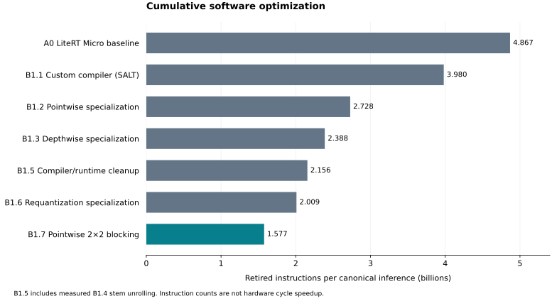

# Cumulative software optimization: A0 and B1.1–B1.7

The submission software sequence starts with frozen LiteRT Micro A0. B1.1
introduces the SALT custom compiler, followed by six cumulative kernel/runtime
optimization stages. The final B1.7 selection
is the accepted standalone RV64IMC implementation with exact requantization and
two-pixel, two-channel pointwise blocking. Fresh reordered captures reproduce
**1,576,585,275 instructions**, 67.61% fewer than A0 and 60.39% fewer than corrected
B1.1. New captures, incremental effects and repeat-validation evidence are in the
[generated cumulative results](../results/profiling/B1-reordered/README.md).
The direct B1.6 → B1.7 step removes **432,784,765 instructions (21.538%)**;
the measured final count, full mix, per-node costs and footprint exactly match
the preserved accepted B1.

Submission labels are separate from frozen evidence names: A0 uses
`results/profiling/B0/`; B1.1 uses compiler config `A0` and
`results/profiling/A0-reordered/`. Existing directories, capture IDs and build
options are preserved. Final B1.7 is also called accepted B1.



## Cumulative selections

| Stage | Added optimization | Purpose |
|---|---|---|
| A0 | Original frozen LiteRT Micro interpreter and reference kernels | Workload reference |
| B1.1 | SALT static graph lowering, preparation and GCC-visible constants | Remove runtime graph work and expose fixed geometry |
| B1.2 | Scalar pointwise dot8 and prepared corrected biases | Replace generic 1×1 convolution loops and per-product offset work |
| B1.3 | Fixed 3×3 and 5×5 depthwise kernels | Unroll interior taps and clip valid border ranges once |
| B1.4 | Function-local GCC loop unrolling for the RGB stem | Measure the historically significant stem compiler improvement independently |
| B1.5 | Standalone runtime, owned numerical helpers and remaining operators; Softmax checked-sum reuse | Group the smaller compiler/runtime improvements |
| B1.6 | Nonpositive-shift requantization with 25 selected inline nodes | Eliminate proven-unneeded arithmetic cases and improve local scheduling |
| B1.7 | Two pixels × two channels pointwise blocking | Reuse activations across channels and weights across pixels |

Every stage retains previous optimizations. B1.5 intentionally groups several
related changes. No stage in this sequence uses OC4. The B1.7 comparison is
against one-pixel, one-channel B1.6; the historical **4.451%** spatial gain was
against OC4 and must not be reused as this sequence's incremental result.

The presentation uses seven bars: A0, B1.1, B1.2, B1.3, B1.5, B1.6 and B1.7.
B1.4 remains a separate measured checkpoint in the complete table. The B1.5
presentation delta combines B1.3 → B1.4 → B1.5. Generated `stages.csv` and
`presentation.csv` distinguish adjacent measured deltas from grouped deltas.

## Reproduction and acceptance

[experiments/software.json](../experiments/software.json) owns the cumulative
options and inline-node selection. Run from the repository root:

```sh
gmake software-plan
gmake software-experiments
```

The [workflow guide](../experiments/README.md) documents setup, partial runs,
resume checks and artifact locations. Generated directories and capture names
are separate from the historical experiments. Each stage's profile embeds its
new immediate parent's summary and manifest identity. Corrected B1.1 is rerun;
frozen A0 remains the original reference. The regressed early compiler is not part
of the sequence.

Each stage builds native, intermediate-capture, sanitizer and RV64 executables.
Native tests compare the public output and complete intermediate arrays on the
pinned oracle cases, including the reference's known rejected Softmax domain.
The actual optimized RV64 ELF then passes ordinary Spike comparison of all
1,000 public output bytes, followed by two identical event/PC profiles of the
canonical seed-1 inference. Sixty-four inclusive units plus invocation overhead
must conserve the full count. The runner performs ISA and heap audits during
RV64 build. `software-report` revalidates immutable capture hashes, parent
lineage, compatibility, totals, and exact B1.7 reproduction of accepted B1's
instruction mix, per-node costs and storage footprint.

The pinned xPack GCC 15.2.0 uses C++17, global `-O2`, `rv64imc`, `lp64`, `medany`,
`-g` and `-fno-builtin`. Only B1.4 onward selects the function-local stem
unrolling policy. A0 keeps its original kernel/runtime build flags. Spike
revision and collector identity, source snapshots, actual build dependencies,
ELF hashes and boundary addresses are saved in capture evidence. The measurement
starts at invocation entry and includes its returning instruction, wrappers,
callees and Softmax preflight; it excludes input setup, output checking and
printing. Allocation is a separate A0 region, absent in generated inference.
See [the profiling contract](compiler-profiling.md).

## How the changes work

SALT validates and prepares the fixed graph offline, plans activation lifetimes
and static storage, and emits 64 direct wrappers. B1.1 exposes corrected shape
fields and prepared scalars directly to GCC; an earlier shape helper hid those
constants under `-fno-builtin`. The original regression and correction are
preserved in [the historical report](B1-software-history.md), with the historical labels retained.

For eligible symmetric-weight 1×1 convolutions, B1.2 precomputes
`corrected_bias[o] = bias[o] - input_zero_point * sum(weight[o,k])` and runs scalar
eight-product reductions. The compiler proves the INT32 accumulator and reduction
prefix bounds. Exact per-channel scaling and activation clamps remain.

B1.3 uses fixed 3×3/5×5 depthwise geometry. Interior pixels avoid repeated padding
checks; border bounds are clipped before channel traversal. Only valid taps get
the input offset, preserving reference border semantics. B1.4 adds the measured
GCC unrolling policy to the still-reference RGB stem.

B1.5 replaces the remaining numerical and operator paths with project-owned
implementations: fixed RGB stem, fully connected reductions, equal-shape ADD,
global average pooling, boundary conversions and exact fixed-point Softmax.
Softmax reuses its already checked normalization sum. This stage retains stem
unrolling, depthwise specialization and scalar pointwise scheduling. Standalone
targets have no TFLM/gemmlowp/ruy kernel dependency; the pinned LiteRT checkout
continues to provide A0/B1.1 and the oracle.

B1.6 proves nonnegative multipliers and shifts in `[-31,0]` for 49 eligible
convolution/depthwise nodes. It removes positive-shift and unreachable saturation
cases while preserving both reference rounding stages. Exactly 25 nodes retain
the accepted inline override; the others use the shared specialized helper.
Those choices originated in the historical order, so their reordered benefit
comes from the new measurement. Inclusive unit savings include caller/compiler
scheduling effects and do not isolate every requantization opcode.

B1.7 maintains four accumulators for two pixels and two channels. Each activation
feeds two channels and each weight feeds two pixels. Corrected biases, reduction
order per output, exact scaling and clamps remain. Odd pixel counts use a safe
one-pixel tail. No extra activation scratch or weight repacking is required.

## Results, tradeoffs and remaining bottlenecks

The [generated results](../results/profiling/B1-reordered/README.md) contain exact
counts and deltas; [instruction mix](../results/profiling/B1-reordered/instruction-mix.csv),
[operator costs](../results/profiling/B1-reordered/operators.csv),
[node costs](../results/profiling/B1-reordered/nodes.csv) and
[footprint](../results/profiling/B1-reordered/footprint.csv) expose benefits and
regressions beyond the whole-model count. Code size is allocated executable
sections; prepared-data size comes from the static memory plan. Workspace and
LiteRT's total arena use different accounting and must not be equated.
The chart also has [PDF](../results/profiling/B1-reordered/optimization-history.pdf)
and [PNG](../results/profiling/B1-reordered/optimization-history.png) exports for
the report and slides. The results README includes affected-family and storage
tables; `scaling-helpers.csv` preserves the narrower out-of-line helper evidence.

The reordered measurements expose different incremental tradeoffs from the old
OC4 path. Depthwise specialization removes 340,305,584 instructions while adding
9,417,956 load/store instructions. B1.6 removes 146,173,412 instructions and
2,725,009 loads/stores while increasing code by 2,392 bytes. The direct 2×2
blocking step removes 432,784,765 instructions and 328,907,897 loads/stores,
but grows executable code from 39,316 to 52,468 bytes (+13,152). Prepared constants
remain 4,915,488 bytes and workspace remains 1,505,280 bytes across B1.2–B1.7.
These figures replace the historical OC4-parent tradeoffs for this presentation.

The accepted final profile remains dominated by pointwise convolution
(74.35% of retirements), followed by 5×5 depthwise (11.50%), 3×3 depthwise (7.89%)
and the RGB stem (5.01%). Scalar multiply/reduction work, load/store and address
work, and fixed-point scaling motivate the subsequent packed-MAC, requantization
and memory experiments. See [the architecture experiment index](../EXPERIMENTS.md)
for their separate controls and evidence.

All instruction counts are measured; differences, percentages, ratios and
artifact sizes are derived. These are cumulative experiments, not independent
ablation effects. Percentages cannot be added. Retired instruction ratios do
not establish CV-Wally cycle speedup. Memory opcodes do not establish cache
misses or DRAM traffic. Hardware cycles, CPI, Fmax, area and performance/area
require compatible RTL/synthesis evidence.

The [original development history](B1-software-history.md) retains the OC2/OC4
trials, separate numerical/runtime checkpoints, broad inlining trials and larger
spatial tiles. Those remain valuable design-space evidence, with their original
parents and measurements preserved. The
[accepted selection record](../results/profiling/B1-software/selection.json)
remains the reference for final B1 and later ISA work.
