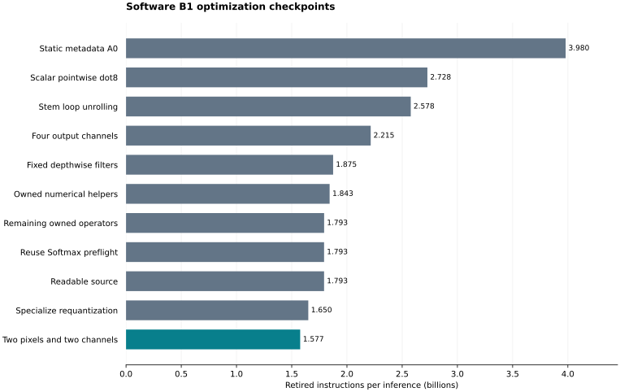

# Software-optimized B1: implementation and profiling report

The accepted software B1 is the standalone RV64IMC implementation with specialized
convolution kernels, exact specialized requantization, and **two-pixel,
two-output-channel pointwise tiles**. It retires **1,576,585,275 instructions** per
canonical full inference: **60.39% fewer than corrected A0**, **42.21% fewer than
the initial B1**, and **67.61% fewer than frozen LiteRT Micro B0**. The last
spatial-blocking step saves **4.45%** against the preceding B1 checkpoint.

Fresh A0 and accepted-B1 profiling runs each produced two identical event and PC
captures, reproduced the preserved checkpoint counts exactly, and compared all
1,000 public output bytes. These results measure **retired instructions**, not
hardware execution time. B1 introduces no custom instructions, floating-point,
vector, or atomic instructions. It is the software baseline for subsequent
Xqmac and requantization ISA experiments.

## 1. Versions being compared

The model is the frozen INT8 EfficientNet-Lite0 graph: 64 operators, 166 tensors,
UINT8 input `[1,224,224,3]`, and UINT8 output `[1,1000]`. All headline measurements
use the same canonical seed-1 synthetic input and invocation boundary.

| Version | Meaning | Full-inference retired instructions | Reduction to accepted B1 | Reference/B1 instruction-count ratio |
|---|---|---:|---:|---:|
| B0 | Frozen original LiteRT Micro interpreter | 4,867,278,370 | 67.61% | 3.0872 |
| A0 | Static compiler, reference kernels, corrected static metadata | 3,980,184,493 | 60.39% | 2.5246 |
| Initial B1 | First scalar pointwise `dot8` checkpoint | 2,728,312,505 | 42.21% | 1.7305 |
| Previous B1 | Selected nonpositive-shift requantization, one-pixel OC4 | 1,650,025,771 | 4.45% | 1.0466 |
| **Accepted software B1** | **Standalone kernels, selected requantization, spatial 2×2** | **1,576,585,275** | — | 1.0000 |

The ratios divide the reference's retired instructions by B1's; they are not
measured hardware speedups. “Initial B1” and “previous B1” are both included
because the B1 label has covered successive optimization checkpoints. A label
does not select compiler behavior: the accepted options are explicit in
[the selection record](../results/profiling/B1-software/selection.json).

The original Stage-4 A0 retired 6,063,975,187 instructions, 24.59% more than B0.
That regression was traced to generated shape construction that hid constants
from GCC. The metadata correction reduced A0 to 3,980,184,493 instructions
before custom B1 kernels were introduced. This report uses that corrected A0
as its primary compiler baseline, so the B1 result does not gain credit for
the earlier fix. The original measurement and investigation remain preserved
in [A0's regression investigation](../results/profiling/A0-regression-investigation/README.md).

## 2. Measurement method and evidence

The compiler executable uses pinned xPack RISC-V GCC 15.2.0, C++17, global `-O2`,
`-g`, `-march=rv64imc`, `-mabi=lp64`, `-mcmodel=medany`, and `-fno-builtin`.
The stem wrapper additionally uses the explicitly selected function-local
`optimize("unroll-loops")` policy. B0 retains its original build, including
`-O2` kernels and `-Os` runtime code; its flags and artifacts were not rewritten
to match the compiler. Full commands, actual dependencies, generated plans,
source snapshots and ELF identities are preserved in build evidence.

Spike revision `19609434bb3d83448eec8796e8f0367c868efbda` executes the ordinary
optimized ELF first for exact correctness, then in the isolated retirement
collector twice. The measured region starts at invocation entry and ends at its
returning instruction. It includes wrappers, callees, quantization and Softmax
preflight; it excludes input preparation, stack painting, verification and
printing. Allocation is a separate B0 phase and is absent from A0/B1 inference.
No zero-cost allocation event is manufactured.

Acceptance requires identical event/PC histograms, exactly the 64 expected
execution units, and complete public-output comparison against the pinned
reference. Every executed PC is partitioned into a unit or invocation overhead;
the 64 inclusive unit totals plus **84 overhead instructions** equal B1's full
count. Exclusive function-body costs remain separate. Invalid boundaries,
unexpected events, stale or mismatched artifacts, unknown executed encodings,
traps, incomplete captures, counter overflow and nonconserving totals are
rejected by the profiling pipeline.

Counts below are **measured**, differences, percentages and work ratios are
**derived**, and ELF/plan storage values are **derived** from saved artifacts.
Cycles, CPI, cache misses, external-memory traffic, clock frequency and area are
**unavailable** here. A load/store opcode counts as one memory instruction
regardless of byte width or cache behavior. Optimized DWARF relationships remain
distinct from compiler-known values and runtime observations. See
[the profiling contract](compiler-profiling.md) for detailed validation rules.

The report-data generator reverified all eleven historical compiler captures,
reconstructed their summaries from saved evidence, checked the frozen B0 summary
hash, and checked model, input and boundary compatibility. Operator comparisons
join logical node IDs rather than addresses. The fresh A0 executable also has
identical loadable bytes to the preserved corrected-A0 executable; its whole-ELF
hash differs because the debug/build evidence differs.

## 3. Optimization history



All counts in this table cover full inference. Each delta compares with the
preceding row. These are sequential experiments, not a leave-one-optimization-out
analysis of final B1: later schedules replace earlier ones, and percentages
cannot be added. The integer savings do telescope from corrected A0 to final B1.

| Checkpoint | Retired instructions | Instructions removed in this step | Reduction in this step |
|---|---:|---:|---:|
| Corrected static-metadata A0 | 3,980,184,493 | — | — |
| Scalar pointwise `dot8` | 2,728,312,505 | 1,251,871,988 | 31.453% |
| Stem loop unrolling | 2,577,746,525 | 150,565,980 | 5.519% |
| Pointwise output-channel blocking, OC4 | 2,215,157,070 | 362,589,455 | 14.066% |
| Fixed 3×3 and 5×5 depthwise kernels | 1,874,851,486 | 340,305,584 | 15.363% |
| Project-owned numerical helpers | 1,843,170,046 | 31,681,440 | 1.690% |
| Remaining project-owned operators | 1,793,359,106 | 49,810,940 | 2.702% |
| Reuse checked Softmax preflight | 1,792,953,997 | 405,109 | 0.023% |
| Readability and explanatory comments | 1,792,953,997 | 0 | 0.000% |
| Selected specialized requantization | 1,650,025,771 | 142,928,226 | 7.972% |
| Spatial pointwise blocking, 2×2 | **1,576,585,275** | **73,440,496** | **4.451%** |

### Static compilation and metadata correction

The A0 foundation imports and validates the fixed graph offline, prepares exact
integer multipliers and shifts, plans tensor lifetimes and storage, and emits
64 direct node wrappers. Constant tensors and parameters reside in read-only
storage. Activations reuse a proven static arena, and the Reshape is a validated
view. Target execution does not parse a FlatBuffer, resolve operators, prepare
quantization parameters or allocate graph objects.

Knowing a value offline is useful only if the generated code exposes it to the
downstream compiler. Early A0 built shapes through a helper that used `memcpy`;
under `-fno-builtin`, GCC could not see the dimensions through that call. Generic
shape and indexing paths survived, with excessive stack traffic. Explicit
dimension assignments and literal prepared scalars expose the fixed values to
GCC without a global optimization-level change. The compiler also validates
fixed geometry and reuses prepared compilation data rather than repeatedly
rebuilding it. Generation-time simplifications receive no inference-speed credit.

The direct invocation overhead is already tiny: B0 uses 4,820 instructions and
A0/B1 use 84. Removing dispatch therefore cannot explain the billion-instruction
gains. Most benefits come from how the arithmetic kernels execute.

### Scalar pointwise kernels and corrected biases

The first custom kernel targets eligible unpadded, stride-one 1×1 convolutions.
For each output channel it computes a dot product rather than running generic
spatial/filter/padding loops. It visits input channels in groups of eight scalar
products, reducing branch and pointer-update overhead. This is scalar unrolling;
it introduces no packed MAC instruction.

For symmetric INT8 weights, the input zero-point correction can be moved offline:

```text
sum((input[k] - input_zero_point) * weight[o,k]) + bias[o]
  = sum(input[k] * weight[o,k]) + corrected_bias[o]
corrected_bias[o] = bias[o] - input_zero_point * sum(weight[o,k])
```

The compiler proves the corrected accumulator and reduction prefixes fit INT32
before selecting this path. Bias preparation adds constant storage but removes
the per-product input-offset arithmetic. Exact per-channel requantization,
output offset and activation clamps are retained. Together these changes remove
1,251,871,988 instructions from corrected A0, a 31.453% reduction. See
[pointwise preparation and emission](compiler.md#stage-5-first-checkpoint-scalar-pointwise-kernels).

### Stem loop unrolling

The fixed RGB 3×3 stride-two stem initially retained the reference kernel. GCC's
global `-O2` heuristics did not choose the best loop form for the specialized
wrapper. A measured function-local unrolling policy reduced its inclusive count
from 277,049,718 to 126,483,738, saving 150,565,980 instructions overall. The
global optimization level remained `-O2`. Later project-stem and requantization
changes reduced this unit further to 78,960,244; these gains belong to their
later checkpoints. [Stem experiment](compiler.md#b1-stem-unrolling-checkpoint).

### Output-channel blocking

OC4 computes four output channels together, with four independent accumulators.
Each loaded activation contributes to four weight rows, reducing repeated input
loads and addressing. Accumulation order within each output remains unchanged.
OC4 reduced full inference by 362,589,455 instructions (14.066%) compared with
the stem checkpoint, and improved all 32 pointwise units. An OC2 candidate was
also measured; OC4 was better at that stage.

This was an intermediate schedule. Final B1 uses two pixels and two channels,
described below, rather than combining OC4 and spatial 2×2 in the same inner
loop. [Channel-blocking experiments](../results/profiling/B1-blocking/README.md).

### Fixed-filter depthwise kernels

The custom 3×3 and 5×5 depthwise kernels use the proven NHWC activation and
1HWO filter layouts, fixed filter dimensions, prepared strides and pointer
increments. Interior pixels execute unrolled 9- or 25-tap reductions without
padding checks. At borders, valid tap bounds are clipped once before the
channel loop, avoiding repeated per-tap coordinate checks and invalid pointers.

Border semantics remain exact: skipped padded taps do not receive an input
zero-point adjustment. These kernels retain the original bias and apply the
input offset to valid taps; applying a full-filter corrected bias at borders
would be wrong. Exact per-channel quantization and fused clamps are preserved.

The two filter families remove 340,305,584 instructions (15.363%) together.
They also **increase** memory instructions by 9,417,956 and executable code by
12,736 bytes. The total instruction improvement is real, but this step did not
improve every metric. [Independent filter-family results](../results/profiling/B1-depthwise-evaluation/README.md).

### Project-owned arithmetic and remaining operators

The project numerical helpers preserve the pinned reference's exact integer
high multiplication, power-of-two division, saturation and rounding. Expressing
those operations in small owned helpers changes GCC's generated arithmetic
without changing the numerical contract. This step saves 31,681,440 instructions
(1.690%), with the same memory-instruction count.

The remaining operators then receive fixed-model implementations:

| Operator | Implementation choice | Inclusive count before replacement | After replacement |
|---|---|---:|---:|
| Stem | Fixed RGB 3×3 taps and valid-border traversal, retaining measured unrolling | 126,483,738 | 90,810,140 |
| Fully connected | Eight-product scalar reductions, exact tail, input offset and final bias | 10,296,433 | 6,931,437 |
| Nine ADD units together | Equal-shape traversal with each input's prepared scaling and exact clamps | 22,697,211 | 12,033,668 |
| Global average pool | Fixed reduction geometry with reference signed rounding | 381,446 | 272,643 |

Boundary UINT8/INT8 conversions and Reshape handling complete operator ownership
while retaining their earlier instruction counts. This operator checkpoint saves
49,810,940 instructions (2.702%). The target no longer needs generic operator
shape/broadcast machinery. It still preserves all model-specific quantization
and border behavior. [Runtime implementations and independent tests](../results/profiling/B1-runtime/README.md).

### Softmax preflight reuse and standalone target

The project Softmax implements the reference fixed-point exponential and
reciprocal algorithms. Its checked preflight already computes the normalization
sum and validates the input domain. Passing that checked sum into normalization
removes the duplicate successful summation pass. The inclusive Softmax cost
falls from 703,878 to 298,769, saving 405,109 instructions overall (0.023%).

The accepted generated executable has no TFLM, gemmlowp or ruy kernel dependency.
The pinned upstream checkout remains the oracle and supports B0/A0 and offline
verification. Local startup, linker and console support under
`tflm/platform/rv64imc/` remains platform code. Framework independence simplifies
the target; it is not a separate unmeasured speedup claim.

### Readability and inspection

Kernel names, local variables, generated argument labels and comments explain
tensor layouts, quantization, loop roles and border behavior. Saved source maps
connect logical graph nodes to generated C++, linked assembly and measured PCs.
Execution and memory plans expose implementations, parameter choices, offsets,
lifetimes and aliases. These changes help users understand the source and
assembly in the viewer.

The readability checkpoint preserved loadable code and data across the checked
configurations and retained exactly 1,792,953,997 retirements. Its measured
performance contribution is **zero**, as intended.

### Specialized requantization with selected inlining

All 49 convolution/depthwise units have nonnegative prepared multipliers and
shifts in `[-31,0]`. The compiler proves those preconditions before choosing
the specialized path. It removes the unused positive-shift case and the
unreachable `INT_MIN × INT_MIN` saturation case. The high-product operation is
equivalent to `(int64(x) * multiplier + 2^30) >> 31` for the supported inputs;
the subsequent rounding right shift remains a separate operation. Preserving
the two rounding stages and tie behavior is essential for byte-exact outputs.

A small out-of-line helper serves most units. Explicitly inlining the operation
at 25 logical nodes wins where GCC's local scheduling benefits; the other 24
eligible units keep the shared helper. The 15 other units retain their previous
policies. The exact node list is saved with the accepted configuration.

All 49 eligible units improve. Full inference loses 142,928,226 instructions
(7.972%), while memory instructions increase by 2,635,985 (0.473%) and code
grows by 3,868 bytes. Broad inlining was measured and rejected: it worsened
13 individual units and generated substantially more memory instructions than
the selected policy. [Requantization comparison](../results/profiling/B1-requantization-comparison/README.md).

### Spatial pointwise blocking: accepted final schedule

Final B1 computes **two spatial pixels and two output channels** together.
Four independent accumulators share two weights across the two pixels and each
activation across two channels. Existing corrected biases, weight layout and
eight-channel scalar reduction groups remain unchanged. Each output retains
its own exact requantization and clamp.

At the reduction-source level, one-pixel OC4 nominally loads one activation and
four weights for four products (1.25 loads/product). Spatial 2×2 nominally loads
two activations and two weights for four products (1 load/product). These are
schedule descriptions, not full-inference measurements: the profile additionally
includes parameters, stores, tails, quantization, spills and wrappers. Odd pixel
counts, including 7×7 layers, finish with a one-pixel tail and never read a
fictitious second pixel. No weight repacking or extra arena scratch is needed.

All 32 pointwise units improve; the other 32 units retain exactly their parent
counts. Full inference loses **73,440,496 instructions (4.451%)**, memory
instructions fall **80,492,219 (14.386%)**, and code shrinks **2,052 bytes**.
Prepared constants and physical memory placements are unchanged from the parent.

Larger tiles were tested, not assumed to be faster:

| Spatial experiment | Full-inference retirements | Change against previous B1 |
|---|---:|---:|
| Previous B1, one-pixel OC4 | 1,650,025,771 | — |
| Two pixels × four channels, parent scaling | 1,775,982,033 | 7.634% more |
| Two pixels × four channels, shared pointwise scaling | 1,797,765,968 | 8.954% more |
| Two pixels × two channels, shared pointwise scaling | 1,598,070,860 | 3.149% fewer |
| **Two pixels × two channels, parent scaling** | **1,576,585,275** | **4.451% fewer** |

The 2×4 kernel keeps eight accumulators live alongside the unrolled reduction,
creating register pressure in this GCC build. Direct SP-relative memory
operations rise from 23,242,865 in the parent to 336,195,323 in the parent-scaling
2×4 trial; assembly contains repeated stack accesses inside reductions. The
accepted 2×2 version records 32,191,414 such operations, but reduces other memory
accesses enough to win overall. Direct SP-relative operands are evidence of
stack accesses, not a complete semantic spill classifier. These measurements
explain the accepted tile choice without claiming every future 2×4 schedule
must lose. [Spatial trials, per-node results and acceptance](../results/profiling/B1-spatial-comparison/README.md).

## 4. Where instructions remain

The following inclusive unit costs include callees and wrappers. Units are
matched by logical graph identity. The exact counts, including boundary
conversions and invocation overhead, conserve full inference.

| Operator family | Units | Corrected A0 | Accepted B1 | Share of B1 |
|---|---:|---:|---:|---:|
| Pointwise convolution | 32 | 2,948,752,390 | 1,172,173,772 | 74.349% |
| Depthwise 5×5 | 9 | 351,012,786 | 181,345,216 | 11.502% |
| Depthwise 3×3 | 7 | 369,177,000 | 124,455,895 | 7.894% |
| Stem convolution | 1 | 277,049,718 | 78,960,244 | 5.008% |
| ADD | 9 | 22,697,211 | 12,033,668 | 0.763% |
| Fully connected | 1 | 10,296,433 | 6,931,437 | 0.440% |
| Softmax | 1 | 703,878 | 298,769 | 0.019% |
| Global average pool | 1 | 381,446 | 272,643 | 0.017% |
| Boundary conversions | 2 | 113,545 | 113,545 | 0.007% |
| Reshape | 1 | 2 | 2 | <0.001% |
| Invocation overhead | — | 84 | 84 | <0.001% |
| **Total** | **64** | **3,980,184,493** | **1,576,585,275** | **100%** |

Pointwise convolution remains the largest target despite a 60.25% reduction
against A0 for that family. Together, pointwise and depthwise account for 93.75%
of remaining retirements. They are the relevant major operators for subsequent
packed-MAC investigation; smaller administrative phases cannot produce a
comparable full-model gain. Per-node comparisons against all four references
are retained in [nodes.csv](../results/profiling/B1-software/nodes.csv).

## 5. Instruction mix and useful-work efficiency

These are measured full-inference opcode classifications. The zero counts are
observations of the successful capture, not substituted unavailable metrics.

| Class | Corrected A0 | Previous B1 | Accepted B1 |
|---|---:|---:|---:|
| Loads | 821,653,417 | 548,354,136 | 463,412,623 |
| Stores | 19,836,200 | 11,155,610 | 15,604,904 |
| Integer ALU | 2,230,445,752 | 655,305,567 | 662,300,556 |
| Multiply | 388,650,056 | 389,024,323 | 389,024,323 |
| Conditional branch | 505,730,836 | 43,520,661 | 43,577,331 |
| Jump/call/return | 13,868,232 | 2,665,474 | 2,665,538 |
| Divide/remainder, custom, other | 0 | 0 | 0 |
| **Total** | **3,980,184,493** | **1,650,025,771** | **1,576,585,275** |

The large A0-to-B1 gains are in integer bookkeeping, loop control and repeated
loads. The last spatial step trades 6,994,989 additional ALU instructions,
56,670 additional conditional branches, 64 additional jumps and 4,449,294
additional stores for 84,941,513 fewer loads. It preserves the multiply count.
This accounts exactly for its net 73,440,496-instruction improvement.

| Full-inference metric | Corrected A0 | Initial B1 | Previous B1 | Accepted B1 |
|---|---:|---:|---:|---:|
| Measured loads + stores | 841,489,617 | 821,977,413 | 559,509,746 | 479,017,527 |
| Derived memory instructions / executed product | 2.207247 | 2.156066 | 1.467607 | 1.256474 |
| Derived executed products / retired instruction | 0.095784 | 0.139735 | 0.231051 | 0.241813 |
| Derived graph MACs / retired instruction | 0.096776 | 0.141182 | 0.233443 | 0.244318 |

B1 has 43.08% fewer memory instructions than corrected A0 and 61.54% fewer than
B0. B0 retires 1,245,579,605 loads/stores. These counts do not measure bytes
transferred or cache traffic.

The graph contains **385,187,552 logical MACs**, while these compiler schedules
execute **381,239,488 useful products** after omitting padded taps. Those are
derived from validated graph and schedule metadata. The **389,024,323 multiply
opcodes** also include scaling and other arithmetic; they do not independently
identify useful MACs. B1's observed custom-instruction count and derived custom
frequency are both zero. Semantic attribution unsupported by saved evidence
remains unavailable.

## 6. Code and memory trade-offs

All quantities below are bytes. Storage categories overlap where noted and must
not be added blindly. Static ELF/plan sizes are derived; the stack watermark is
observed on the canonical input rather than a universal bound.

| Storage category | Corrected A0 | Initial B1 | Previous B1 | Accepted B1 |
|---|---:|---:|---:|---:|
| Allocated executable sections | 23,240 | 24,352 | 54,520 | 52,468 |
| Allocated read-only sections | 4,868,072 | 4,916,136 | 4,915,984 | 4,915,984 |
| Planned constants/parameters, included in read-only storage | 4,867,424 | 4,915,488 | 4,915,488 | 4,915,488 |
| Planned activation/scratch workspace, included in BSS | 1,505,280 | 1,505,280 | 1,505,280 | 1,505,280 |
| Allocated BSS | 1,505,424 | 1,505,424 | 1,505,424 | 1,505,424 |
| Initialized writable sections | 20 | 20 | 20 | 20 |

Final code is 29,228 bytes larger than A0, reflecting specialization and unrolling,
but 2,052 bytes smaller than the preceding B1 and 64,448 bytes smaller than B0's
116,916-byte executable sections. Corrected biases add 48,064 bytes of planned
parameters compared with A0. Read-only storage grows by 47,912 bytes overall
because other read-only content also changes. The observed stack watermark grows
from A0's 416 bytes to B1's 584 bytes; spatial blocking does not increase it
above the preceding B1.

B0 reserves a 2 MiB arena and reports 1,688,176 bytes used, including persistent
runtime objects. Its total BSS is 2,097,872 bytes. That arena-used figure has a
different scope from the compiler's activation workspace; subtracting them
would not isolate an activation-memory improvement. B0's total read-only storage
is 5,439,736 bytes, including its embedded model and runtime content. Address-space
mapping, stack reservation, BSS, observed stack usage and peak live tensor storage
remain separate concepts.

## 7. Correctness and visibility acceptance

The accepted spatial implementation passed **205 compiler tests**, five collector
tests and eight real-B1 browser scenarios. Its independent spatial-kernel tests
run under ASan/UBSan and cover 240 fixtures, 1,500 calls and 500,100 complete
output bytes, including odd and single-pixel tails, multiple batches, both
channel blocks, numerical policies, extreme values, asymmetric zero points,
clamps and guards.

Eight oracle input cases are retained: canonical seed 1, all-zero, all-maximum,
public zero point, alternating extremes, ramp, seed 42 and seed `deadbeef`.
Seven complete inferences and the known failure prefix produce **510 complete
intermediate-array comparisons per capture/sanitized build**. Ordinary RV64
correctness and both fresh full profiles compare all 1,000 public output bytes.
The oracle remains pinned TFLM revision
`9f638f18154dff868e7053572f089be845b2fbdf`.

The all-131 public-input case still returns status 2 at Softmax node 62 before
writing its output. This known reference-domain limitation remains explicit
diagnostic evidence; it is never included as a successful performance result.
The deterministic synthetic inputs establish exact equivalence on those cases,
not dataset-level image accuracy.

Isolated replay covers nodes 1, 4, 8, 15, 58, 61 and 62 on all eight cases plus
two checked scalar-dot fixtures: **58 fixtures per native/sanitized/RV64
executable**. Runtime operands are restored from verified oracle snapshots,
constants come from compiled parameters, and restoration, guards and complete
output comparison remain outside the measured region. Replay ELF identities
and counts remain separate from in-model profiles. Wider existing fixtures
also exercise residual-input restoration and aliases.

GCC diagnostics cover the five executable translation units and are attached
only after identical loadable bytes are verified. The v2 viewer bundle preserves
graph → generated source → assembly navigation, PC counts, loop/register views,
execution choices, planned memory and build provenance. It excludes model-weight
payloads by default. GCC/DWARF mapping gaps remain visible rather than being
filled with invented register roles.

The accepted checkpoint's [verification record](../results/profiling/B1-spatial-comparison/verification.json)
binds test logs, differential results, replay, GCC and viewer identities. All 40
frozen B0 artifacts remain unchanged. The fresh profiles add repeated measurement
evidence to these existing gates; report generation changes no kernel code.

## 8. Accepted configuration and reproduction

Use the explicit software-B1 targets; historical `--config B1` defaults remain
available for reproducing the first pointwise checkpoint.

```sh
gmake compiler-b1-software-build
gmake compiler-b1-software-verify
# Full correctness gate plus two matching full-inference captures:
gmake compiler-b1-software-checkpoint
```

The accepted generator options are:

```text
--config B1 --stem-unroll --depthwise-kernels 3 5 --runtime standalone
--requantization nonpositive --pointwise-pixels 2 --pointwise-block 2
--requantization-inline-nodes 1 2 3 4 5 6 7 8 9 11 12 14 15 18 19 20 21 22 25 26 29 41 44 48 52
```

The build directory retains its experiment name, `build/compiler/B1-spatial2-oc2`.
The software-B1 checkpoint target explicitly selects those options and writes
`results/profiling/B1-software/`; its default comparison parent is corrected A0.
`B1_SOFTWARE_PARENT_CAPTURE` can point to a restored compatible capture.

For fresh profiles of already verified builds without regenerating source:

```sh
uv run --python 3.12 python tools/profile_compiler.py run \
  --build-manifest build/compiler/A0/rv64/build.json \
  --checkpoint A0-software-report \
  --results-dir results/profiling/A0-software-report
uv run --python 3.12 python tools/profile_compiler.py run \
  --build-manifest build/compiler/B1-spatial2-oc2/rv64/build.json \
  --checkpoint B1-software \
  --results-dir results/profiling/B1-software
```

Raw captures and immutable source/ELF snapshots live under ignored build storage;
compact summaries, the selection record, exact-integer comparison JSON, CSVs and
figure are tracked under `results/profiling/`. Retain or restore the ignored
captures to reverify historical evidence. New build paths/debug information or
manifest provenance may produce new content IDs even when loadable bytes and
counts match; use the actual emitted capture IDs when regenerating report data.

To regenerate this report's data and figure from its saved captures:

```sh
uv run --python 3.12 --with-requirements tools/compiler/requirements.txt \
  --with matplotlib==3.10.3 python tools/report_b1_software.py \
  --a0-capture build/profiling/compiler/f3f565ebd1909200760a730000e431d62aae9b28025b32feb1fe856183d761e8 \
  --b1-capture build/profiling/compiler/ae2e34b227a93a4004fd5f68408f772581619aaf6a1a2ac0ed73cb54817a33de \
  --plot
```

The script verifies the eleven historical captures named in the tracked
checkpoint summaries, fresh A0/B1 compatibility, instruction/category totals and
logical-node contributions before writing data. Matplotlib is optional unless
`--plot` is used. It does not compile kernels or infer performance from source.

| Evidence | Identity or location |
|---|---|
| Model SHA-256 | `31c18ecf5cfb7bddf182e450e4029834271fc70e15b5fae6ddb5995ac2a6de51` |
| Canonical input SHA-256 | `656c4935ee43649bf2d57b7b82e4394ea1c9a528b6c0c63148b8c787362d976b` |
| Expected output SHA-256 | `6df1afb3691f347c05e8e671989c0c2121a6a295ec52a38b11c1422db03e070e` |
| Fresh A0 capture | `f3f565ebd1909200760a730000e431d62aae9b28025b32feb1fe856183d761e8` |
| Fresh accepted-B1 capture | `ae2e34b227a93a4004fd5f68408f772581619aaf6a1a2ac0ed73cb54817a33de` |
| Accepted B1 ELF SHA-256 | `d9f1f72d52c386f39edb5f4b331c5d6b0351f26f18dfa50daa0d1e6fcc5914d9` |
| B1 build-evidence SHA-256 | `e29aae2e2003cec8ab4e141077a7b11920e4d7d47199b2e4b2f1be6adc6e3910` |
| Exact comparisons and history | [comparison.json](../results/profiling/B1-software/comparison.json), [checkpoint-history.csv](../results/profiling/B1-software/checkpoint-history.csv) |
| Fresh measured summary | [B1-software](../results/profiling/B1-software/README.md), [A0-software-report](../results/profiling/A0-software-report/README.md) |
| GCC analysis | [B1-spatial2-oc2-gcc](../results/profiling/B1-spatial2-oc2-gcc/summary.json) |
| Isolated replay | [B1-spatial2-oc2-replay](../results/profiling/B1-spatial2-oc2-replay/summary.json) |
| Viewer archive | `build/explorer/B1-spatial2-oc2.zip` |

The accepted software-B1 executable is identified by its ELF and frozen build
evidence, including the working-tree sources used to build it. Commit
`67c7d02` is the preceding requantization checkpoint, not the complete final
spatial implementation. Subsequent ISA experiments must retain this software
baseline, exact correctness checks and repeated full profiling, and add hardware
measurements before making cycle or timing claims.
