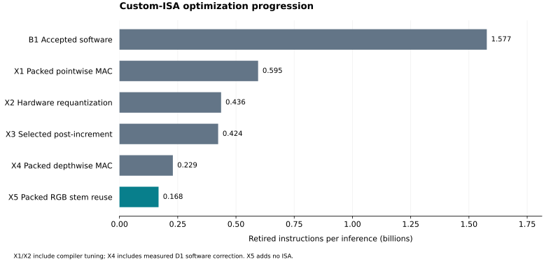
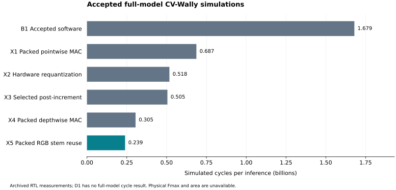

# Custom-ISA optimization analysis

The accepted hardware-era progression is **B1 → X1 → X2 → X3 → X4 → X5**.
X1, X2, X3 and X4 introduce distinct architectural mechanisms; X5 restructures
software around the existing ISA. Compiler refinements stay inside their major
stage, with measured substages retained for attribution. D1 separately measures
software correction before the X4 depthwise ISA.

The [generated hardware results](../results/profiling/hardware-progression/README.md)
contain the exact instruction, cycle, CPI, operator, opcode-utilization and
storage tables, together with SVG/PNG/PDF figures. The
[unified submission package](../results/submission/README.md) connects them to
the A0 LiteRT baseline and cumulative B1.1–B1.7 software sequence.
B1.1 introduces the custom compiler; accepted B1 is B1.7. Historical evidence
retains `B0` for LiteRT and compiler configuration `A0` for SALT.

## X1: packed pointwise arithmetic and kernel tuning

Xqmac8 accumulates eight signed INT8 products into one wrapping INT32 result,
sign-extended into the destination RV64 register. It does not introduce eight
independent accumulators. The initial X1.1 checkpoint retains B1's scalar 2×2
pointwise schedule and software requantization, isolating the new instruction.

X1.2 strengthens packed-weight alignment from four to eight bytes, enabling
efficient 64-bit operand loads. X1.3 keeps the already sign-extended result in
a 64-bit C++ register variable; the architectural arithmetic remains INT32.
X1.4 changes the tile to two pixels × four channels, which wins after packed
MAC changes the register-pressure tradeoff. The main X1 result groups these
refinements. See [Xqmac8 semantics and experiments](xqmac8.md) and
[its RTL implementation](cvw-xqmac8.md).

## X2: exact hardware requantization and register-pressure tuning

Xrequant replaces a fixed-point output-scaling sequence while preserving the
reference's two rounding stages, shifts, output offset and clamp. Its descriptor
also supports scale-only residual ADD intermediates. X2.1 introduces the ISA on
the final X1 2×4 configuration.

X2.2 outlines depthwise pixel functions at eight selected nodes to reduce live
ranges and stack accesses. Its production-compiler capture reproduces the
historical prototype's 436,487,389 instructions. X2.3 keeps residual ADD
intermediates in 64-bit registers within proven INT32 arithmetic bounds. Both
refinements are compiler scheduling changes, not new architectural features.
The main X2 bar is the final `X2-optimized` result. See
[the ISA contract](xrequant.md), [compiler investigation](xrequant-optimization.md)
and [RTL](cvw-xrequant.md).

## X3: selected post-increment addressing

Post-increment instructions access memory through the old pointer and update
the base on successful completion. Loads produce both data and an updated base,
which requires dual-result writeback, forwarding and precise fault handling in
the core. This is architecturally distinct despite its modest whole-model gain.

Broad and selected policies are alternatives from the same optimized X2 parent.
The selected policy avoids the regressing depthwise geometries and is the main
X3 checkpoint. Keep the broad trial as supporting design-space evidence; do not
present broad → selected as an extra cumulative ISA stage. See
[semantics and selection](xpostinc.md) and [RTL](cvw-xpostinc.md).

## D1 and X4: separate software correction from depthwise hardware

D1 precomputes `bias - input_zero_point * sum(valid_weights)` for each distinct
valid-tap border geometry and selects the matching correction vector at runtime.
It retains X3's ISA. This avoids charging a software zero-point optimization to
the new hardware instruction.

Xdwmac8 then performs eight signed INT8 products into eight independent wrapping
INT32 accumulators. Set/get pair instructions initialize and read the bank.
The architectural bank adds 256 bits of accumulator state per hart. This state
size alone does not establish mapped area or total hardware cost. D1 and X4
use identical prepared constants and physical memory plans; all 16 depthwise
nodes improve while other node counts remain equal.

Use D1 → X4 for instruction-level attribution to the bank ISA. The main X4
presentation compares against X3 and groups D1 with X4. The full-model RTL cycle
comparison also uses X3 → X4, since a D1 cycle capture is unavailable. See
[the bank and border contract](xdwmac8.md) and [RTL](cvw-xdwmac8.md).

## X5: reuse the existing packed MAC for the RGB stem

X5 changes only stem node 1. It gathers a 27-value RGB patch once per output
pixel, zero-pads to 32 lanes in four 64-bit words, and shares that patch across
32 output channels. Prepared weight rows and valid-border correction vectors
preserve exact arithmetic. Four Xqmac8 instructions reduce each output channel;
requantization is unchanged. No whole-image im2col buffer or new instruction is
introduced.

The final X5 proof includes the identical X4 RTL simulator binary and
configuration, so the improvement is attributed to software exploiting the
existing ISA. See [packed-stem design and verification](stem.md).

## Measurement and presentation rules

All instruction results use canonical seed-1 input, exact 1,000-byte public
outputs and two identical event/PC profiles with the same invocation boundary.
Per-node joins use logical graph identity. The manifest explicitly records
options; labels never select behavior. Historical captures retain their original
names and parent evidence. The new comparison graph is validated separately.

RTL cycles are accepted only for matching workload executables and complete
verified inference. CPI and cycle speedups are derived from those measurements.
New Spike builds must prove identical loaded programs before using archived RTL
cycles; equal instruction totals are insufficient. Intermediate substages and
D1 receive no invented cycle results.

Post-increment opcodes remain classified as loads/stores and also contribute to
custom utilization. Counts of load/store instructions do not measure cache
misses or DRAM traffic. Whole-stage instruction reductions include the recorded
compiler/schedule choices; they are not independent leave-one-feature-out effects.
Physical Fmax, mapped area and speedup/area require synthesis evidence, which
remains blocked by the recorded DC startup failure.

Use `gmake hardware-experiments` to validate the sequence and generate its
reports, `gmake hardware-recapture` for distinct fresh Spike captures, and
`gmake submission-report` to regenerate the complete software/hardware evidence
package. See [the workflow](../experiments/hardware.md) and
[submission checklist](submission.md).
