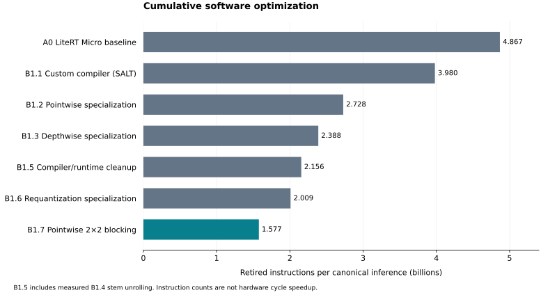

# Cumulative software optimization results

Generated by `gmake software-report` from validated captures and `experiments/software.json`. A0 is the LiteRT Micro baseline; B1.1 introduces the SALT custom compiler. Historical capture/configuration names remain unchanged.

Chart exports: [SVG](optimization-history.svg), [PNG](optimization-history.png), [PDF](optimization-history.pdf).

| Stage | Change | Retired instructions | Removed vs previous stage | Reduction | Reduction from A0 |
|---|---|---:|---:|---:|---:|
| A0 | LiteRT Micro baseline | 4,867,278,370 | 0 | 0.000% | 0.000% |
| B1.1 | Custom compiler (SALT) | 3,980,184,493 | 887,093,877 | 18.226% | 18.226% |
| B1.2 | Pointwise specialization | 2,728,312,505 | 1,251,871,988 | 31.453% | 43.946% |
| B1.3 | Depthwise specialization | 2,388,006,921 | 340,305,584 | 12.473% | 50.938% |
| B1.4 | Stem loop unrolling | 2,237,440,941 | 150,565,980 | 6.305% | 54.031% |
| B1.5 | Compiler/runtime cleanup | 2,155,543,452 | 81,897,489 | 3.660% | 55.714% |
| B1.6 | Requantization specialization | 2,009,370,040 | 146,173,412 | 6.781% | 58.717% |
| B1.7 | Pointwise 2×2 blocking | 1,576,585,275 | 432,784,765 | 21.538% | 67.608% |

## Affected operators

Positive values are instructions removed from the immediate measured parent; negative values are increases. B1.6 includes caller scheduling and cannot isolate all scaling arithmetic.

| Stage | Focus | Instructions removed in focus | Removed elsewhere | Loads/stores removed in focus |
|---|---|---:|---:|---:|
| B1.1 | All operators (custom compilation) | 887,089,141 | 4,736 | 404,088,039 |
| B1.2 | Pointwise convolution | 1,251,871,988 | 0 | 19,512,204 |
| B1.3 | Depthwise 3x3, Depthwise 5x5 | 340,305,584 | 0 | -9,417,956 |
| B1.4 | Stem convolution | 150,565,980 | 0 | 21,935,279 |
| B1.5 | All operators (grouped runtime) | 81,897,489 | 0 | -1,190,343 |
| B1.6 | Pointwise convolution, Depthwise 3x3, Depthwise 5x5, Stem convolution | 146,173,412 | 0 | 2,725,009 |
| B1.7 | Pointwise convolution | 432,784,765 | 0 | 328,907,897 |

## Storage tradeoffs

| Stage | Executable bytes | Prepared constants/parameters bytes | Activation workspace bytes |
|---|---:|---:|---:|
| A0 | 116,916 | — | — |
| B1.1 | 23,240 | 4,867,424 | 1,505,280 |
| B1.2 | 24,352 | 4,915,488 | 1,505,280 |
| B1.3 | 37,092 | 4,915,488 | 1,505,280 |
| B1.4 | 37,344 | 4,915,488 | 1,505,280 |
| B1.5 | 36,924 | 4,915,488 | 1,505,280 |
| B1.6 | 39,316 | 4,915,488 | 1,505,280 |
| B1.7 | 52,468 | 4,915,488 | 1,505,280 |

The chart uses seven bars. B1.4 is retained in the stage table; the B1.5 presentation delta combines B1.4 and B1.5. `presentation.csv` contains those grouped deltas. `stages.csv` always compares adjacent measured stages.

B1.7 reproduces the accepted B1 full instruction mix, per-operator metrics and footprint exactly. The historical OC4 path and its 4.451% final-step reduction remain historical evidence; they are not deltas for this reordered sequence.

`instruction-mix.csv` records loads, stores, integer ALU, multiply and branch counts plus MAC ratios. `operators.csv` and `nodes.csv` record inclusive family/node costs and adjacent-stage savings. `footprint.csv` records executable bytes, constants, read-only storage and workspace. `validation.json` identifies the immutable captures and acceptance checks.

`functions.csv` retains exclusive function-body counts for generated stages. `scaling-helpers.csv` summarizes identifiable out-of-line fixed-point multiplier bodies. Selected inlining moves arithmetic into callers, so this helper-only count is not the total requantization cost or an estimate of the B1.6 benefit; use adjacent whole-model/node deltas for that comparison.

A0 (historical B0) uses the original collector rather than a compiler capture ID; its frozen summary and raw-capture hashes are recorded in `validation.json`. Empty A0 prepared-data/workspace cells mean unavailable under the compiler's memory-plan accounting, not zero bytes.

Counts are measured retirements; differences, ratios and artifact sizes are derived. Inclusive operator costs include requantization and callees; there is no claim that all arithmetic or all B1.6 savings can be isolated as requantization instructions. Memory opcodes do not measure cache misses or external traffic. Spike provides no hardware cycle speedup, CPI, area or Fmax evidence. A0 retains the frozen LiteRT flags and invocation boundary; B1.1–B1.7 use the same pinned compiler and generated-invocation boundary. Historical evidence paths/configurations retain B0 for LiteRT and A0 for static compilation.

Every new stage passed native output, intermediate-array and sanitizer comparison against the pinned oracle (including the known rejected Softmax domain), ordinary Spike comparison of 1,000 output bytes, and two identical event/PC profiles on seed-1 input. Each stage directory contains its detailed summary and experiment receipt. Raw captures and complete source/build snapshots remain under ignored `build/`; rerun the sequence to regenerate them on a clean checkout.
