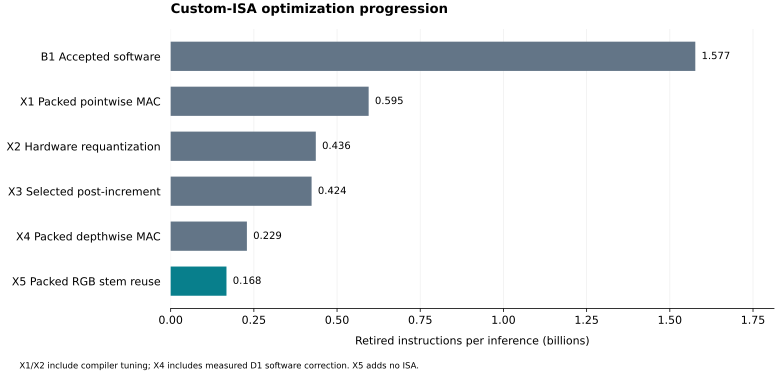
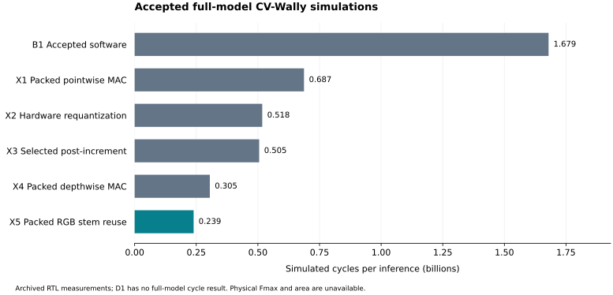

# Hardware-era optimization progression

Generated by `gmake hardware-report` from explicit configurations and revalidated immutable Spike/archived RTL evidence.

| Main stage | Retired instructions | Reduction from accepted parent | Simulated cycles | Cycle reduction | CPI |
|---|---:|---:|---:|---:|---:|
| B1 | 1,576,585,275 | 0.000% | 1,679,179,098 | 0.000% | 1.0651 |
| X1 | 594,975,670 | 62.262% | 687,052,832 | 59.084% | 1.1548 |
| X2 | 436,158,109 | 26.693% | 517,650,202 | 24.656% | 1.1868 |
| X3 | 423,520,020 | 2.898% | 505,154,402 | 2.414% | 1.1928 |
| X4 | 229,114,977 | 45.902% | 305,047,330 | 39.613% | 1.3314 |
| X5 | 167,729,178 | 26.793% | 239,303,116 | 21.552% | 1.4267 |

Main X1 and X2 include their compiler refinements. Main X4 compares against X3 and includes D1. X5 changes the stem software using existing Xqmac8; it adds no hardware instruction.

## Measured substages and controls

| Stage | Comparison parent | Change | Kind | Retired instructions | Removed | Reduction |
|---|---|---|---|---:|---:|---:|
| B1 | — | Accepted software | software_baseline | 1,576,585,275 | 0 | 0.000% |
| X1.1 | B1 | Introduce Xqmac8 | new_isa | 750,711,402 | 825,873,873 | 52.384% |
| X1.2 | X1.1 | Align packed weights | compiler_tuning | 664,927,440 | 85,783,962 | 11.427% |
| X1.3 | X1.2 | Wide accumulator registers | compiler_tuning | 624,684,209 | 40,243,231 | 6.052% |
| X1.4 | X1.3 | Pointwise 2×4 tile | compiler_tuning | 594,975,670 | 29,708,539 | 4.756% |
| X2.1 | X1.4 | Introduce Xrequant | new_isa | 458,701,498 | 136,274,172 | 22.904% |
| X2.2 | X2.1 | Selected depthwise outlining | compiler_tuning | 436,487,389 | 22,214,109 | 4.843% |
| X2.3 | X2.2 | Wide residual ADD registers | compiler_tuning | 436,158,109 | 329,280 | 0.075% |
| X3.broad | X2.3 | Broad post-increment trial | alternative_trial | 428,833,239 | 7,324,870 | 1.679% |
| X3 | X2.3 | Selected post-increment | new_isa | 423,520,020 | 12,638,089 | 2.898% |
| D1 | X3 | Border-exact zero-point correction | software_control | 389,566,544 | 33,953,476 | 8.017% |
| X4 | D1 | Packed depthwise MAC | new_isa | 229,114,977 | 160,451,567 | 41.187% |
| X5 | X4 | Packed RGB stem reuse | software_on_existing_isa | 167,729,178 | 61,385,799 | 26.793% |

B1 → X5 removes 89.361% of retired instructions (9.400× instruction-count ratio) and gives 7.017× simulated cycle speedup. This is not a physical execution-time or performance/area result.

D1 is a software-only control with no separate full-model RTL cycles in the archived records. X4's ISA-only instruction comparison is D1 → X4; its main-stage cycle comparison is X3 → X4. Never assign D1 a zero or interpolated cycle count.

X3.broad and selected X3 are alternatives from the same optimized X2 parent. They are not sequential cumulative stages. X2.2 is a new production-compiler measurement; it reproduces the historical outlining prototype at 436,487,389 instructions. Prototype investigations remain separate historical evidence.

## Evidence and interpretation

`stages.csv` records explicit comparison edges; `presentation.csv` groups the accepted main stages. `cycles.csv` records only measured accepted RTL configurations. `instruction-mix.csv`, `custom-utilization.csv`, `operators.csv`, `nodes.csv` and `footprint.csv` expose opcode use, affected operators, regressions and storage cost. Every table identifies stages from `experiments/hardware.json`.

The preserved capture's original parent is retained in `validation.json` alongside the submission comparison parent. Existing captures are not renamed or rewritten. Comparisons are recomputed after checking the same model, input, boundary and logical node identities; X2.3 and X4 therefore retain their historical capture parents while their incremental comparisons use X2.2 and D1.

All stages have complete 1,000-byte canonical output checks, two identical event/PC captures, and exactly 64 conserving execution units. Every frozen plan must equal the production selector's reconstruction from the manifest. Original summary reporter-version hashes may differ from the current reporter; every other summary field must reproduce exactly.

Archived RTL PASS records are checked against selected ELF hashes, workload contracts, per-opcode retirements, monitor gates and simulator identities. Custom-stage output bytes are decoded and rehashed from local archived snapshots. The baseline B1 archive retains the output hash/PASS record rather than raw bytes. These are revalidated existing RTL measurements; this report does not claim new RTL runs.

Post-increment instructions remain in the load/store mix and are also counted in custom utilization; do not add custom frequency back into the instruction-mix total. Loads/stores are instruction counts, not cache misses or external traffic. Ratios, CPI, deltas and artifact sizes are derived from measured evidence.

Physical Fmax, mapped area and speedup/area remain unavailable because synthesis is blocked at DC startup. See `results/synthesis/baseline/README.md`. Raw captures and RTL snapshots remain in ignored `build/`; their identities are recorded in `validation.json`.

Reproduction: `gmake hardware-experiments` verifies retained evidence and runs gates; `gmake hardware-recapture` creates distinct fresh Spike builds/captures without overwriting history. `gmake hardware-report` regenerates reports only. RTL setup, directed/replay commands and full-model run/collection instructions remain in `docs/cvw-verilator.md` and the extension-specific guides.

Figures are available as SVG, PNG and PDF: `instruction-progression.*` and `cycle-progression.*`. The unified A0 → B1.1–B1.7 → X1–X5 package is in `results/submission/`.
