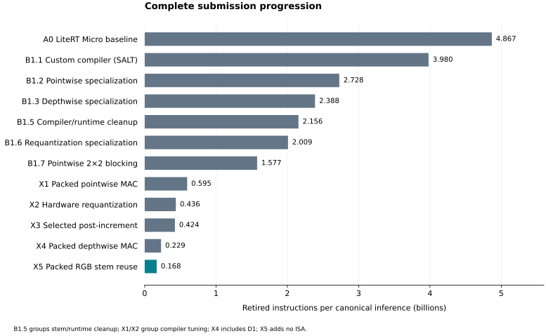

# Submission evidence package

Submission A0 is frozen LiteRT Micro (historical evidence/configuration name B0); B1.1 is the custom compiler (historical config A0). Accepted B1 means final B1.7. Existing capture identities are unchanged.

The main progression is **A0 → B1.1 → B1.2 → B1.3 → B1.5 → B1.6 → B1.7 → X1 → X2 → X3 → X4 → X5**.

| Stage | Change | Retired instructions | Reduction from preceding presentation stage |
|---|---|---:|---:|
| A0 | LiteRT Micro baseline | 4,867,278,370 | 0.000% |
| B1.1 | Custom compiler (SALT) | 3,980,184,493 | 18.226% |
| B1.2 | Pointwise specialization | 2,728,312,505 | 31.453% |
| B1.3 | Depthwise specialization | 2,388,006,921 | 12.473% |
| B1.5 | Compiler/runtime cleanup | 2,155,543,452 | 9.735% |
| B1.6 | Requantization specialization | 2,009,370,040 | 6.781% |
| B1.7 | Pointwise 2×2 blocking | 1,576,585,275 | 21.538% |
| X1 | Packed pointwise MAC | 594,975,670 | 62.262% |
| X2 | Hardware requantization | 436,158,109 | 26.693% |
| X3 | Selected post-increment | 423,520,020 | 2.898% |
| X4 | Packed depthwise MAC | 229,114,977 | 45.902% |
| X5 | Packed RGB stem reuse | 167,729,178 | 26.793% |

## Supporting measurements

- [Software stages and footprint](../profiling/B1-reordered/README.md): B1.4 remains measured independently and is grouped into B1.5 in the main presentation.
- [Hardware-era stages, ablations, opcode use and cycles](../profiling/hardware-progression/README.md): X1.1–X1.4 and X2.1–X2.3 remain measured; X3.broad is an alternative trial; D1 isolates software correction before X4.
- [Design map](../../DESIGN.md), [experiment workflow](../../EXPERIMENTS.md), [requirements and remaining deliverables](../../docs/submission.md).

Accepted hardware-era configurations have full-model RTL cycles; D1 and the intermediate software/compiler stages do not acquire cycle results by interpolation. X5 reuses the exact X4 RTL simulator. Physical Fmax/area remain unavailable; this package does not replace the final report, presentation or synthesis-cost evidence.

Run `gmake submission-report` to regenerate and cross-check the software, hardware and unified evidence package. `gmake hardware-experiments` runs hardware-era verification gates and revalidates retained captures; `gmake hardware-recapture` explicitly generates separate fresh Spike captures. Hardware full-model reruns use the pinned Linux/WSL workflow and exact workload contracts in the RTL guide.
